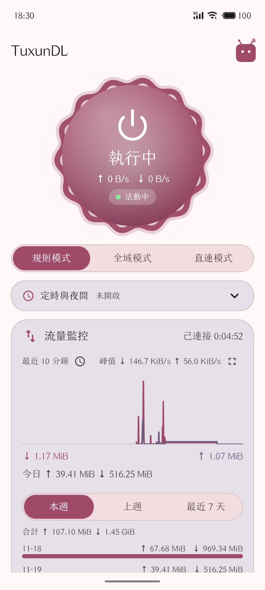

<p align="center"><a href="README.md">简体中文</a> | <b>English</b></p>

<p align="center">
  
</p>

<h1 align="center">TuxunDL</h1>

<p align="center">
  An open-source, highly customizable proxy client for Android, Windows, Linux and Mac, powered by the mihomo core.
</p>

<p align="center">
  <a href="https://github.com/liyuzhou79-star/TuxunDL/releases/tag/v1.6.0"></a>
  <a href="https://github.com/liyuzhou79-star/TuxunDL/releases/tag/win-v1.6.11"></a>
  <a href="https://github.com/liyuzhou79-star/TuxunDL/releases/tag/linux-v1.1.1"></a>
  <a href="https://github.com/liyuzhou79-star/TuxunDL/releases/tag/mac-v1.0.1"></a>
  <a href="https://github.com/liyuzhou79-star/TuxunDL/releases"></a>
  <a href="https://github.com/liyuzhou79-star/TuxunDL/actions/workflows/build-debug.yaml"></a>
  
  
  
  
  
  
  <a href="https://github.com/liyuzhou79-star/TuxunDL/commits/main"></a>
</p>

<p align="center">
  <a href="https://github.com/liyuzhou79-star/TuxunDL/releases/latest"><b>Download the latest version</b></a> ·
  <a href="#features">Features</a> ·
  <a href="#editions">Editions</a> ·
  <a href="#changelog">Changelog</a> ·
  <a href="CONTRIBUTING.md">Contributing</a>
</p>

---

<p align="center">
  
</p>

## About

TuxunDL is a fully open-source (GPL-3.0) proxy client powered by the [mihomo](https://github.com/MetaCubeX/mihomo) core, available for **Android, Windows, Linux and Mac**, all developed in this single repository. Its defining word is **customization** — theme colors, home layout, card toggles, node favorites, rule editing and DNS overrides are all yours to change.

The Android edition is built with Kotlin + Jetpack Compose + Material 3, with a little antenna robot as its mascot. The desktop editions (Windows / Linux / Mac) are written from scratch (code in the `desktop/` directory, fully original), use a window-shaped mascot, and also run on mihomo — the core is bundled in the installer, so it works right after installation.

## Download

Go to [Releases](https://github.com/liyuzhou79-star/TuxunDL/releases) and open the latest release page for your platform. **Every release page carries the latest installers for all four platforms — Android, Windows, Linux and Mac** — so even when a release only updates one platform, the current versions of the others are attached on the same page. No need to dig through old pages.

**Latest version of each platform (direct links to the release pages):**

- Android: [1.6.0](https://github.com/liyuzhou79-star/TuxunDL/releases/tag/v1.6.0)
- Windows: [1.6.11](https://github.com/liyuzhou79-star/TuxunDL/releases/tag/win-v1.6.11)
- Linux: [1.1.1](https://github.com/liyuzhou79-star/TuxunDL/releases/tag/linux-v1.1.1)
- Mac: [1.0.1](https://github.com/liyuzhou79-star/TuxunDL/releases/tag/mac-v1.0.1)
- Android TV: [0.1.0 Beta](https://github.com/liyuzhou79-star/TuxunDL/releases/tag/tv-v0.1.0-beta) (prerelease)

### Android

| Edition | File | Package name | For |
| --- | --- | --- | --- |
| Standard | `tuxundl-<version>-arm64.apk` | `com.tuxundl.android` | 64-bit devices (Android 5.0+) |
| Legacy | `tuxundl-<version>-legacy-armeabi-v7a.apk` | `com.tuxundl.android.legacy` | 32-bit older devices; can be installed alongside the standard edition |

The app has a built-in update check (manual check in Settings, or a full-screen prompt when a new version is available) and picks the right installer for your edition automatically. All versions are signed with the same fixed signing key, so upgrades install directly over the old version.

Archives of every version are also available from [GitHub Packages](https://github.com/liyuzhou79-star/TuxunDL/pkgs) (GitHub login required to download).

### Windows

| File | For |
| --- | --- |
| `TuxunDL-<version>.msi` | Windows 10 / 11, 64-bit (MSI installer) |
| `TuxunDL-<version>.exe` | Windows 10 / 11, 64-bit (EXE installer) |

Pick either one. The mihomo core is bundled; no separate download is needed. System-proxy mode needs no administrator rights; TUN mode must run as administrator. The Windows edition checks only `win-v` Windows releases for updates.

### Linux

| File | For |
| --- | --- |
| `TuxunDL-<version>.deb` | Debian / Ubuntu family, 64-bit (deb package, installs to `/opt/com.tuxundl.linux`) |
| `TuxunDL-<version>.AppImage` | Most mainstream distributions, 64-bit (no installation; add the executable permission and run) |

Shares the same desktop codebase as the Windows edition (independent version numbers, starting at 1.0.0), with the mihomo core bundled. Automatic system-proxy setup supports the GNOME desktop (on other desktops, set 127.0.0.1:7890 manually); TUN mode uses pkexec to run only the core as root — the app itself stays unprivileged. The Linux edition checks only `linux-v` Linux releases for updates.

### Mac

| File | For |
| --- | --- |
| `TuxunDL-<version>.dmg` | macOS, Apple Silicon (M-series chips), 64-bit (DMG disk image) |

Shares the same desktop codebase as the Windows / Linux editions (independent version numbers, starting at 1.0.0), with the mihomo core bundled. System proxy is configured through `networksetup` (for the active network service, usually Wi-Fi; an administrator account is required); TUN mode is not supported yet. The Mac edition checks only `mac-v` Mac releases for updates. The app is unsigned and not notarized, so on first launch right-click → Open to bypass Gatekeeper; Intel Macs are not supported yet.

## Features

### Android edition

#### Connections & nodes
- Import subscriptions by link / config file, or by scanning a QR code from the photo album
- Node search, favorites pinned on top, latency sorting (untested nodes sink to the bottom)
- Speed tests: every node shows "testing…" during a full test, timeouts are marked in red, and tapping a latency value re-tests that node alone
- Routing modes: Rule / Global / Direct, one tap to switch
- Per-app proxy: search + third-party apps filter

#### Traffic statistics
- Live chart on the home screen: smooth curve for the last 2 minutes with peak markers
- Advanced mode (tap the stats card): hourly traffic for the last 24 hours, connection duration, connection quality rating (average latency / jitter / failure rate / stutter count)
- Daily and weekly statistics, and connection bookmarks (save a connection's node, duration, traffic and quality as a record card)
- Subscription traffic and expiry reminders (warning at 80% usage, reminder 3 days before expiry)

#### Personalization
- Robot mascot with tap Easter eggs (total traffic / connection time / days used)
- Four-state animation on the big round start button: breathing when disconnected, spinning handshake while connecting, halo heartbeat when connected, a little shake on error
- App-wide spring animation system, tuned per element; switchable animation styles in Appearance: Spring / Soft / Reduced
- Long-press drag to rearrange the home screen: tiles and cards go where you want them
- Custom theme colors: 16 curated colors + HSL sliders for any color; dark mode; home card toggles

#### Advanced
- Visual routing-rule editor (no need to edit subscription files)
- Custom DNS overrides (Nameserver / Fallback, fully revertible)
- Home-screen widget: one-tap start/stop, current node and live speed
- Settings backup & restore: profiles, rules, DNS, favorites and appearance, export / restore in one tap
- Log search and level filtering

### Windows edition

- Big round start button on the home page; once connected it shows the current node and live up/down speeds
- Two connection modes: system proxy / TUN, switchable in Settings; the local mixed port is changeable
- Subscription management: add, update and switch subscriptions; settings are stored locally
- Nodes page: nodes grouped by provider group, tap to switch, per-node latency test
- Rules and Logs pages: see the active rules plus app and core logs
- System tray: closing the window keeps it running; quitting from the tray restores the system proxy automatically
- Update checks only follow Windows releases (`win-v` tags), never mixing with the Android edition

### Linux edition

- The same desktop program as the Windows edition, with the same features: big round start button, subscription management, grouped nodes with latency tests, Rules and Logs pages, first-run guide, changeable data directory
- Automatic system-proxy setup supports the GNOME desktop (via gsettings); on other desktops, follow the manual instructions in Settings
- TUN mode uses pkexec to run only the core as root — the app itself stays unprivileged
- Autostart uses XDG autostart; the default data directory is `~/.local/share/tuxundl`
- Update checks only follow Linux releases (`linux-v` tags)

### Mac edition

- The same desktop program as the Windows edition, with the same features: big round start button, subscription management, grouped nodes with latency tests, Rules and Logs pages, first-run guide, changeable data directory
- System proxy is configured automatically through `networksetup`; autostart uses a LaunchAgent; the default data directory is `~/Library/Application Support/tuxundl`
- Apple Silicon only for now; unsigned and not notarized, so on first launch right-click → Open to allow it
- TUN mode is not supported yet — please use system-proxy mode
- Update checks only follow Mac releases (`mac-v` tags)

### Android TV edition (Beta)

- A TV branch of the same codebase as the phone app, with its own package name `com.tuxundl.android.tv` — it can be installed alongside the phone edition and shows the same TuxunDL name
- Supports both Google TV and domestic Chinese TV systems: no Google services required, remote-control focus navigation, installers for both 32-bit and 64-bit TVs with "Beta" in the filename
- Currently a Beta prerelease: a few pages (such as drag sorting and chart gestures) still await remote-control adaptation, and the TV edition does not check for updates yet

## Editions

- **Android standard & legacy editions**: identical features; they differ only in CPU architecture and package name. Every Android version ships both editions — neither is ever skipped.
- **Windows edition**: independent version numbers starting at 1.0.0, release tags use `win-v<version>` (Android uses `v<version>`).
- **Linux edition**: independent version numbers starting at 1.0.0, release tags use `linux-v<version>`.
- **Mac edition**: independent version numbers starting at 1.0.0, release tags use `mac-v<version>`; Apple Silicon only for now.
- **Android TV edition (Beta)**: separate package name `com.tuxundl.android.tv`, release tags use `tv-v<version>-beta`; currently a Beta prerelease, and installer filenames carry "Beta".
- **All platforms on every page**: every GitHub release page attaches the latest installers for all four platforms. If a release only updates the phone app, the current desktop installers are on the same page — and vice versa. The release notes state clearly which platform a release updates.

## Changelog

Full version history is in [CHANGELOG.md](CHANGELOG.md); details for each version are on its [Release page](https://github.com/liyuzhou79-star/TuxunDL/releases).

## Building from source

Android edition:

```bash
git clone https://github.com/liyuzhou79-star/TuxunDL.git
cd TuxunDL
./gradlew --no-daemon app:assembleAlphaRelease   # standard edition
./gradlew --no-daemon app:assembleAlphaRelease -PtuxundlLegacy  # legacy edition
```

Requires JDK 21, Android SDK 35 and Go (for the core build).

Desktop editions (a standalone Gradle build in the `desktop/` directory, independent of the Android build):

```bash
./gradlew -p desktop run            # run
./gradlew -p desktop packageMsi     # build the MSI installer (Windows)
./gradlew -p desktop packageExe     # build the EXE installer (Windows)
```

Requires JDK 17. Packaging automatically downloads the mihomo core and wintun and bundles them into the installer (not committed to the repo). See [desktop/README.md](desktop/README.md) for details.

Every version of this repository is also built automatically by GitHub Actions.

## Contributing

Issues and PRs are welcome — please read [CONTRIBUTING.md](CONTRIBUTING.md) first. For security issues, see [SECURITY.md](SECURITY.md).

## Contributors

- [liyuzhou79-star](https://github.com/liyuzhou79-star)
- museai

## Credits

- [mihomo](https://github.com/MetaCubeX/mihomo) — the proxy core used by all platforms
- [ClashMetaForAndroid](https://github.com/MetaCubeX/ClashMetaForAndroid) — the base project of the Android edition
- [Wintun](https://www.wintun.net) — the virtual network adapter driver used by TUN mode on Windows (© WireGuard LLC)
- Everyone who tried the app and reported issues

The desktop code is entirely original to this project; the boundary between upstream and original code is documented in detail in [desktop/README.md](desktop/README.md).

## License

GPL-3.0. This project is for learning and personal use only; please comply with the laws and regulations of your location.
