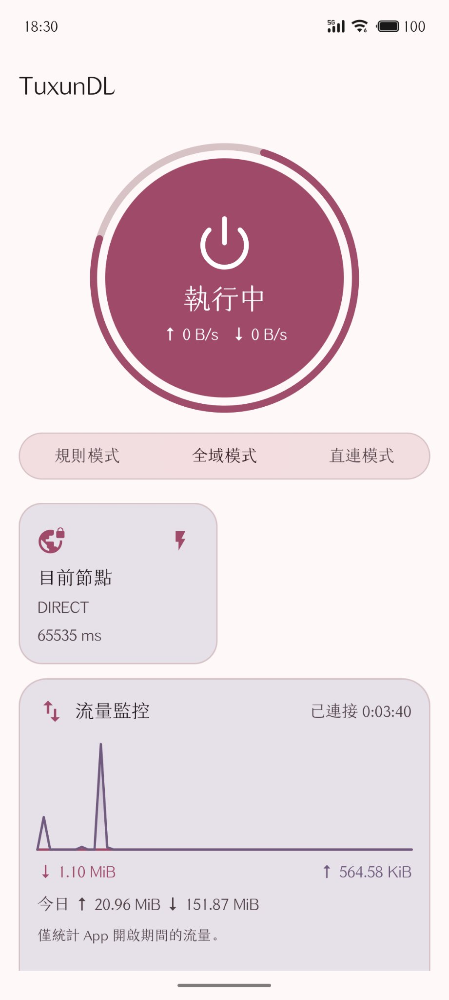

<p align="center">
  
</p>

<h1 align="center">TuxunDL</h1>

<p align="center">
  高自訂、強個性化的開源 Android 代理工具，基於 mihomo 核心。<br>
  An open-source, highly customizable Android proxy client powered by the mihomo core.
</p>

<p align="center">
  <a href="https://github.com/liyuzhou79-star/TuxunDL/releases"></a>
  <a href="https://github.com/liyuzhou79-star/TuxunDL/releases"></a>
  <a href="https://github.com/liyuzhou79-star/TuxunDL/actions/workflows/build-debug.yaml"></a>
  
  
  
  <a href="https://github.com/liyuzhou79-star/TuxunDL/commits/main"></a>
</p>

<p align="center">
  <a href="https://github.com/liyuzhou79-star/TuxunDL/releases/latest"><b>下載最新版 / Download</b></a> ·
  <a href="#功能總覽--features">功能</a> ·
  <a href="#版本一覽--editions">版本一覽</a> ·
  <a href="#更新紀錄--changelog">更新紀錄</a> ·
  <a href="CONTRIBUTING.md">參與貢獻</a>
</p>

---

<p align="center">
  
</p>

## 這是什麼 / About

TuxunDL 是一個完全開源（GPL-3.0）的 Android 代理客戶端，核心採用 [mihomo](https://github.com/MetaCubeX/mihomo)，介面以 Kotlin + Jetpack Compose + Material 3 全新打造。主打一個詞：**自訂**——主題色、首頁排版、卡片開關、節點收藏、規則編輯、DNS 覆寫，能自己改的全都開放給你改。

吉祥物是右上角那隻天線連著節點的小機器人，在 App 裡連點它三下有彩蛋。

## 下載 / Download

到 [Releases](https://github.com/liyuzhou79-star/TuxunDL/releases/latest) 下載最新版，兩個版本永遠同版本號、同一個發布頁：

| 版本 | 檔案 | 包名 | 適合 |
| --- | --- | --- | --- |
| 標準版 | `tuxundl-<版本>-arm64.apk` | `com.tuxundl.android` | 64 位元新機型（最低 Android 5.0） |
| 老機型版 | `tuxundl-<版本>-legacy-armeabi-v7a.apk` | `com.tuxundl.android.legacy` | 32 位元舊機型，可與標準版共存安裝 |

App 內建檢查更新（設定頁手動檢查，或有新版時開啟 App 全屏提醒），會依你的版本自動挑對的安裝包。所有版本都用同一把固定簽名鑰匙簽署，可直接覆蓋安裝。

也可以從 [GitHub Packages](https://github.com/liyuzhou79-star/TuxunDL/pkgs) 取得每個版本的封存（需登入 GitHub 才能下載）。

## 功能總覽 / Features

### 連接與節點
- 訂閱連結 / 設定檔匯入，相簿掃碼加訂閱
- 節點搜尋、收藏置頂、延遲排序（未測沉底）
- 測速體驗：全部測速時每個節點顯示「測速中…」，超時紅字標示，點延遲數字可單獨重測
- 分流模式：規則 / 全域 / 直連一鍵切換
- 分應用代理：搜尋＋只看第三方應用

### 流量統計
- 首頁即時圖表：最近 2 分鐘平滑曲線＋峰值標示
- 進階模式（點統計卡開啟）：近 24 小時每小時流量、連接時長、連接品質評級（平均延遲 / 抖動 / 失敗率 / 卡頓次數）
- 每日與每週統計、本次連接收藏（把這次連接的節點、時長、流量、品質存成紀錄卡）
- 訂閱流量與到期提醒（用量 80% 警示、到期前 3 天提醒）

### 個性化
- 吉祥物小機器人＋連點三下彩蛋（累計流量 / 連接時長 / 使用天數）
- 大圓啟停按鈕四態動畫：未連接呼吸、連接中旋轉握手、已連接光環心跳、出錯小晃
- 全 App 彈簧動畫系統，逐元素專屬調校；外觀頁可切「動畫風格」：彈簧 / 柔和 / 減少動畫
- 首頁長按拖拽排版：磚塊與卡片位置自己排
- 自訂主題色：16 個精選色＋HSL 三滑桿任意調色；深色模式；首頁卡片開關

### 進階玩法
- 可視化分流規則編輯器（不用改訂閱檔）
- 自訂 DNS 覆寫（Nameserver / Fallback，可完整還原）
- 桌面小組件：一鍵啟停、看目前節點與速率
- 設定備份還原：設定檔、規則、DNS、收藏、外觀一鍵匯出 / 還原
- 日誌搜尋與等級篩選

## 版本一覽 / Editions

標準版與老機型版功能相同，差別只在處理器架構與包名。每個版本都同時發布，不會有哪一版被漏掉。

## 更新紀錄 / Changelog

完整版本歷史見 [CHANGELOG.md](CHANGELOG.md)，每個版本的詳細說明見對應的 [Release 頁面](https://github.com/liyuzhou79-star/TuxunDL/releases)。

## 從原始碼編譯 / Build

```bash
git clone https://github.com/liyuzhou79-star/TuxunDL.git
cd TuxunDL
./gradlew --no-daemon app:assembleAlphaRelease   # 標準版
./gradlew --no-daemon app:assembleAlphaRelease -PtuxundlLegacy  # 老機型版
```

需要 JDK 21、Android SDK 35 與 Go（核心編譯）。本倉庫的每個版本也都由 GitHub Actions 自動編譯。

## 參與貢獻 / Contributing

歡迎 issue 與 PR，請先看 [CONTRIBUTING.md](CONTRIBUTING.md)。安全問題請看 [SECURITY.md](SECURITY.md)。

## 致謝 / Credits

- [mihomo](https://github.com/MetaCubeX/mihomo) — 代理核心
- [ClashMetaForAndroid](https://github.com/MetaCubeX/ClashMetaForAndroid) — 基礎工程
- 所有試用並回報問題的使用者

## 授權 / License

GPL-3.0。本專案僅供學習與個人使用，請遵守所在地法律法規。
